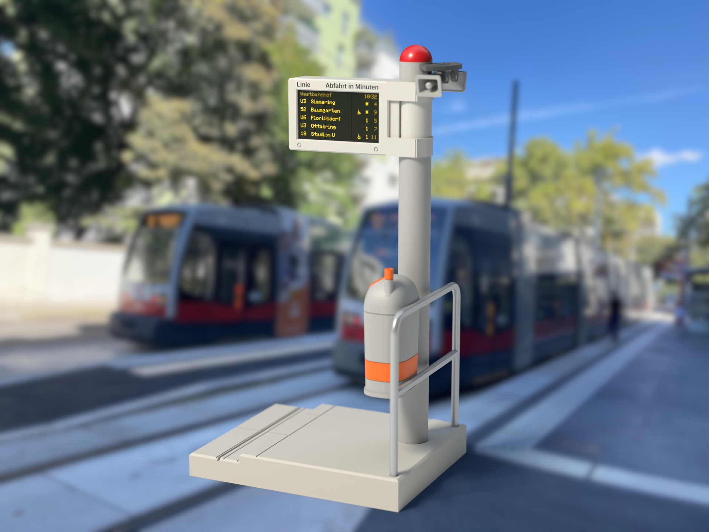
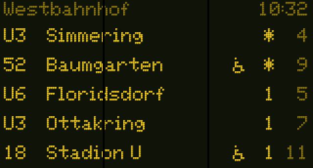
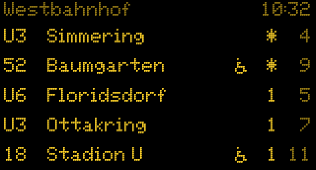
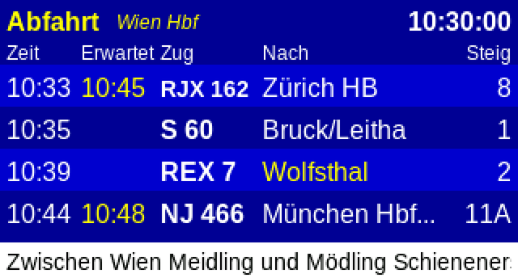
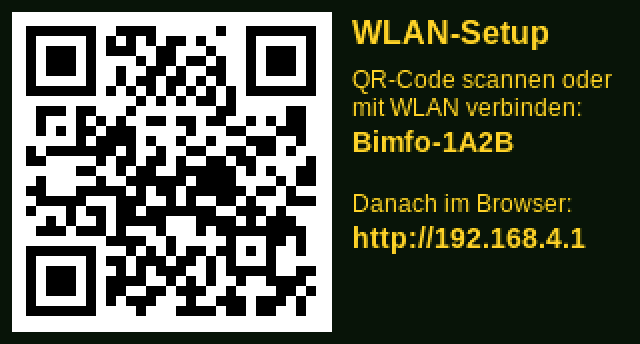

# Bimfo

[](https://github.com/livus/bimfo/releases/latest)
[](LICENSE)
[](enclosure/LICENSE)
[](https://docs.espressif.com/projects/esp-idf/en/v5.5.2/)

**Live tram, bus, U-Bahn and train departures for Vienna, in a 3D-printed replica of the classic
Wiener Linien stop display.**

Bimfo is an open-source departure monitor for the Waveshare
**ESP32-S3-LCD-1.47B**. It shows real-time departures from the Wiener Linien and ÖBB APIs for the
stops you choose, set up from your phone through a page the device serves itself. The printable
enclosure is a 1:15 model of Vienna's original *Bim* (tram) and bus stop displays.



## Hardware

For the complete assembly you will need:

- A Waveshare **ESP32-S3-LCD-1.47B** (e.g. from [Semaf](https://electronics.semaf.at/ESP32-S3-147-LCD-Entwicklungsboard-Type-B) if you live in Vienna),
  with or without soldered pin headers.
- A **90° "side-angle" USB-C cable**: the cable leaves the plug sideways, along its long side, and
  is at most 4.4 mm thick. The plug head must fit in about 11 × 17.5 × 7.2 mm, for example the Lindy
  32005. A straight plug doesn't fit. Alternatively, solder a thin two-wire lead to the VBUS and G
  pads next to the USB port. Two short test prints check the board and the cable
  ([how](enclosure/README.md#check-the-board-and-your-cable)).
- A USB power supply.
- The printed enclosure: STLs, Bambu Studio projects and instructions are in
  [`enclosure/`](enclosure/README.md). It also prints as a static model without the electronics.

## Features

Three styles, switchable on the settings page or with the BOOT button:

| Wiener Linien | Kompakt | ÖBB |
|---|---|---|
|  |  |  |
| A replica of the LED displays at tram and bus stops, on the green glow of their panel: three departures with line and minutes in big digits, the destination over two rows with U-Bahn and S-Bahn symbols, a wheelchair for low-floor trams, a jumping square when a vehicle leaves now and a leading zero for times from the timetable. More lines are shown page by page; when the next tram is not low-floor, it takes turns with the next one that is (wheelchair blinking). Like the real ones, no clock and no traffic info (can be switched on). While it connects, a low-floor tram pulls in and out under the wire. | The same LED font on plain black, made for reading at a glance: stop name and clock on top, five departures. | Colours, columns and fonts of the ÖBB station monitors: Zeit / Erwartet / Zug / Nach / Steig, delays in yellow, a white notice strip. |

- Any mix of Wiener Linien stops (tram, bus, U-Bahn, night bus) and ÖBB stations (S-Bahn,
  regional and long-distance trains).
- Optional grouping: one row per line with the next two departures.
- A walking time per stop hides departures you can no longer reach.
- Disruption notices as a scrolling ticker.
- Brightness, night mode, refresh interval, 180° rotation.
- Firmware updates: automatically at night if you switch it on, or uploaded on the settings page.
  Only updates signed with the Bimfo key are accepted, and a broken one rolls back by itself.

## Installing the firmware

**[Install from the browser](https://livus.github.io/bimfo/)**: open the page in Chrome or Edge
on a computer, connect the board with a USB-C cable and click *Install Bimfo*. No software needed. On
a new board, tick *Erase device* when asked; when updating, leave it unticked to keep the settings.

Every [release](../../releases/latest) also has the files for other ways:

| File | For |
|---|---|
| [`bimfo-update.bin`](../../releases/latest/download/bimfo-update.bin) | Updates over Wi-Fi: settings page → System → *Firmware-Datei hochladen*. Keeps the settings. |
| [`bimfo-full.bin`](../../releases/latest/download/bimfo-full.bin) | A first install with esptool: `esptool.py --chip esp32s3 write_flash 0x0 bimfo-full.bin`. Erases the settings. |

To build it yourself, see [Building and flashing](#building-and-flashing).

## Setup



1. **First start:** the display shows *WLAN-Setup* with a QR code. Join the open network
   `Bimfo-XXXX` (scan the code); the setup page opens by itself (captive portal), otherwise browse
   to `http://192.168.4.1`.
2. Enter your Wi-Fi and save. The device restarts and shows `http://bimfo.local` and its IP.
3. Open that address on any device in the same network and add stops:
   * **Wiener Linien:** search the station, tick lines and directions (live list); nothing ticked
     means all lines.
   * **ÖBB:** search the station, optionally "nur Züge" and a line filter (`S 50, REX 51`).
   * The walking time per stop hides departures you cannot reach any more.
4. Display settings: style, grouping, brightness, night mode, refresh interval, 180° rotation.

**BOOT button** (in the enclosure: the tab under the box, near the pole): short press switches the
style; hold 3 s to open the setup Wi-Fi for 10 minutes, for example when moving to another network.

### Updates

On the settings page under *System*:

* **Automatische Updates** (off by default): every night between 3 and 4 o'clock the device looks
  for a new release on GitHub and installs it. It restarts once, and the settings are kept.
* **Jetzt prüfen** checks right away, whether automatic updates are on or not.
* **Firmware-Datei hochladen** installs a `bimfo-update.bin` you downloaded yourself.

Either way, the device only installs firmware signed with the same key as the firmware it runs:
an official Bimfo release accepts only official releases. A file from elsewhere, or one changed
on the way, is refused. Automatic updates also skip versions that aren't newer, and versions that
already failed to start once. A new version that doesn't start properly is rolled back at the next
restart. Flashing over USB (browser installer, esptool) always works, whatever is installed.


## Building and flashing

ESP-IDF 5.5 (the VS Code ESP-IDF extension works as-is). Dependencies (LVGL 8.3, mDNS) are fetched
by the component manager.

```
idf.py build
idf.py -p COM8 flash monitor
```

The partition table differs from the Waveshare demo (two OTA slots), so the first flash must be done
over USB. Optional for development: `idf.py menuconfig` → *Bimfo* → Wi-Fi credentials (stored only
in the untracked `sdkconfig`, used until Wi-Fi is set on the device).

`idf.py build` leaves the app unsigned. An unsigned build runs normally but accepts no updates over
the network (the settings page says so); flash it over USB. To use updates with your own builds,
for example in a fork, make your own key, sign with it, and set *Bimfo → Firmware for automatic
updates* to your repository:

```
espsecure.py generate_signing_key --version 2 --scheme rsa3072 my-key.pem
espsecure.py extract_public_key --version 2 --keyfile my-key.pem tools/bimfo-release-key.pub.pem
python tools/release.py --key my-key.pem      # signed images in dist/
```

### First flash on the hardware: checklist

Everything above the hardware glue is tested on the PC; these points can only be confirmed on the
board:

1. `idf.py -p COMx erase-flash flash monitor` (erase once: new partition table).
2. The boot screen appears in landscape, yellow-amber on a dark background. If red and blue look
   swapped, the panel colour order in `platform/lcd.c` (`rgb_endian`) is the place to look.
3. Setup screen: the QR code scans and joins `Bimfo-XXXX`; the phone pops up the page.
4. Save Wi-Fi → restart → `http://bimfo.local` is reachable; add a stop; departures appear within a
   few seconds; the log shows `fetch: N departures`.
5. Page → Anzeige → "Anzeige um 180° drehen": the picture turns and is still aligned (no offset
   stripe).
6. BOOT button: a short press switches the style, holding it 3 s brings back the setup screen.
7. The brightness slider and night mode change the backlight; 0 % turns it off.
8. Install a signed build: `python tools/release.py --key …` and the browser installer (below).
   Upload `dist/release/bimfo-update.bin` on the page → it restarts into the other OTA slot (the
   status line shows `ota_1`). Uploading the unsigned `build/bimfo.bin` is refused.

### Releasing

The version is in `version.txt`; the settings page shows it. To release:

1. Raise `version.txt` (for example to `1.1.0`) and commit.
2. Tag and push: `git tag v1.1.0 && git push origin main v1.1.0`.

3. GitHub asks you to approve the build (an e-mail and a notice on the workflow run). Approve it.

The [release workflow](.github/workflows/release.yml) builds the firmware with ESP-IDF 5.5.2, signs
it with the release key, publishes a GitHub release with the update and full images, the licence
and the third-party notices, and deploys the browser installer ([`web/`](web/index.html)) with the
same firmware to GitHub Pages. Devices with automatic updates switched on install it the next
night. The workflow stops if the tag doesn't match `version.txt`, or if the key doesn't match
[`tools/bimfo-release-key.pub.pem`](tools/bimfo-release-key.pub.pem).

**The release key** is an RSA-3072 key (`espsecure.py generate_signing_key --version 2 --scheme
rsa3072`). Its public half is in the repository; the private key is kept by the maintainer and in
the GitHub secret, never in the repository. Keep a backup: devices running a release accept
updates only with this key, so without it they can only be updated over USB.

One-time setup on GitHub:

1. Settings → Pages → Source: *GitHub Actions*.
2. Settings → Environments → *New environment* `release`:
   * *Required reviewers*: yourself.
   * *Deployment branches and tags*: *Selected branches and tags*, add the tag rule `v*`.
   * *Environment secrets*: `BIMFO_SIGNING_KEY`, with the whole content of the private key file
     (including the `BEGIN`/`END` lines).

Only a tag build that you approved can read the key: someone who can push but can't approve can't
publish a signed update.

`python tools/release.py --key PATH` (in an ESP-IDF shell, after `idf.py build`) makes the same
files locally in `dist/`. To try the installer: `python -m http.server -d dist/site 8000`, then open
`http://localhost:8000` in Chrome or Edge.


## Testing without the device

Everything that is not hardware glue builds on the PC (MinGW gcc or any C11 compiler, plus CMake):

```
cmake -S host -B host/build -G Ninja
cmake --build host/build
host/build/bimfo_tests     # unit tests against captured real API responses
host/build/bimfo_fuzz      # truncated/corrupted payloads, random DNS packets
host/build/bimfo_render    # PNG screenshots of all screens -> host/out/index.html
```

`bimfo_render` runs the exact UI code and LVGL version of the firmware against a frame buffer, so
layout changes can be checked in seconds.

`python host/live_check.py` fetches fresh responses for several large stations from the real
services (same URLs as the firmware) and runs them through the firmware parsers via `bimfo_parse`:
a quick way to notice API changes (`--save` refreshes the fixtures).

The configuration page can be developed against a fake device:

```
python host/mock_server.py            # fixtures; add --live to query the real services
cd host/webtest && npm install && npm test   # end-to-end test of the page (jsdom)
```

### Running the firmware in QEMU

The real firmware also boots in Espressif's QEMU (`idf_tools.py install qemu-xtensa`).
`sdkconfig.qemu` switches PSRAM to the emulated quad mode and replaces Wi-Fi by QEMU's `open_eth`
Ethernet, so the device fetches live data and serves its web API:

```
idf.py -B build_qemu -D SDKCONFIG=build_qemu/sdkconfig -D "SDKCONFIG_DEFAULTS=sdkconfig.defaults;sdkconfig.qemu" build
cd build_qemu && esptool.py --chip esp32s3 merge_bin --fill-flash-size 16MB -o qemu_flash.bin @flash_args
qemu-system-xtensa -nographic -machine esp32s3 -m 8M -drive file=qemu_flash.bin,if=mtd,format=raw \
    -nic user,model=open_eth,hostfwd=tcp::8090-:80
```

The configuration page is then at `http://localhost:8090/`. The LCD is not emulated (the UI still
renders, frames are dropped), and QEMU uses software AES/SHA because its crypto blocks cannot DMA
from PSRAM.

`python host/qemu_smoke.py` automates this: it boots the image, configures a Wiener Linien and an
ÖBB stop through the device's API, waits for the device's own HTTPS fetches, and checks the board,
heap, per-task stack head-room (`/api/status` → `stack_free`) and the serial log. Then it tests
updates:

* **Upload:** a random file, an unsigned image and an image signed with another key are refused. A
  correctly signed image is installed, and the device restarts into the other slot with its
  settings.
* **Automatic update:** the update comes from a local server that redirects like GitHub releases.
  The same version isn't installed, and a newer one signed with another key is refused. A newer,
  correctly signed one is installed.

The QEMU build is signed at build time with a test key,
[`host/qemu_test_signing_key.pem`](host/qemu_test_signing_key.pem). That key is public and is
never used for releases. Run the smoke test in an ESP-IDF shell; it signs its test images with
`espsecure`.

## Data sources

* Wiener Linien OGD realtime API (`/ogd_realtime/monitor`, CC BY 4.0, Stadt Wien –
  data.wien.gv.at). Selected platforms are queried by RBL number, otherwise the whole station by
  DIVA. Station search uses the official `haltestellen.csv` (cached in PSRAM).
* ÖBB: the Scotty/HAFAS station board (`fahrplan.oebb.at/bin/stboard.exe`,
  `outputMode=tickerDataOnly`) and station search (`ajax-getstop.exe`), the same unofficial
  endpoints other open-source monitors use; they may change without notice.

Bimfo is an independent project, not affiliated with Wiener Linien or ÖBB.

## Licence

* **Firmware, host tools and scripts:** [MIT](LICENSE).
* **The enclosure** (everything in `enclosure/`: model, STL/3MF files, images, decal sheet):
  [CC BY-NC-SA 4.0](enclosure/LICENSE). Print it, share it and remix it for non-commercial use,
  crediting "Bimfo by Sebastian Röder", with remixes under the same licence. Selling prints or kits needs
  permission.
* Third-party code, fonts and data keep their own licences; see
  [THIRD_PARTY_NOTICES.md](THIRD_PARTY_NOTICES.md).

## Credits

* Fonts: Liberation Sans (SIL OFL 1.1), Adafruit GFX 5×7 (BSD).
* Panel driver: Espressif's esp_lcd ST7789 driver as adapted in the Waveshare demo (Apache-2.0).
* Departure data: Wiener Linien / Stadt Wien – data.wien.gv.at (CC BY 4.0); ÖBB Scotty.
* Render backgrounds: a CC0 photo from Wikimedia Commons and a CC0 HDRI from Poly Haven
  (see [`enclosure/render/`](enclosure/render/README.md)).
* Inspired by the [catch.it / Straba](https://www.catch.it)
  mini-stops.
