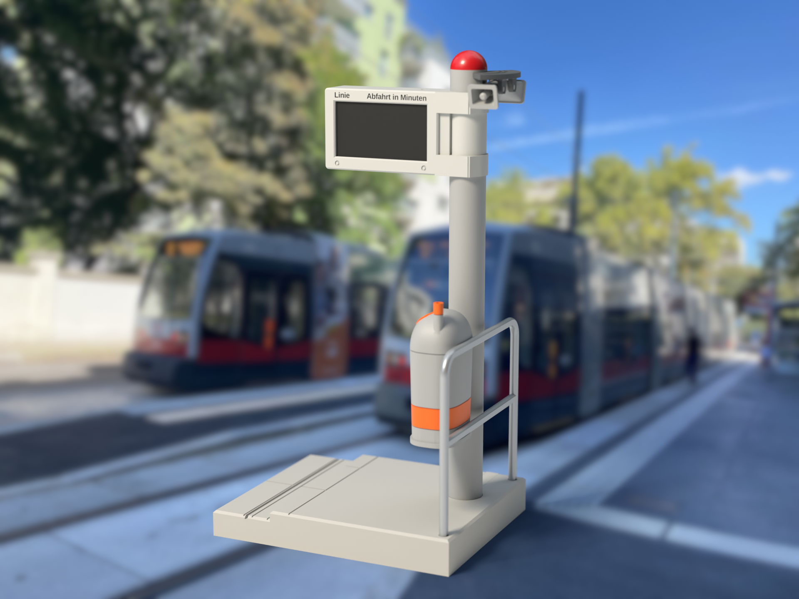
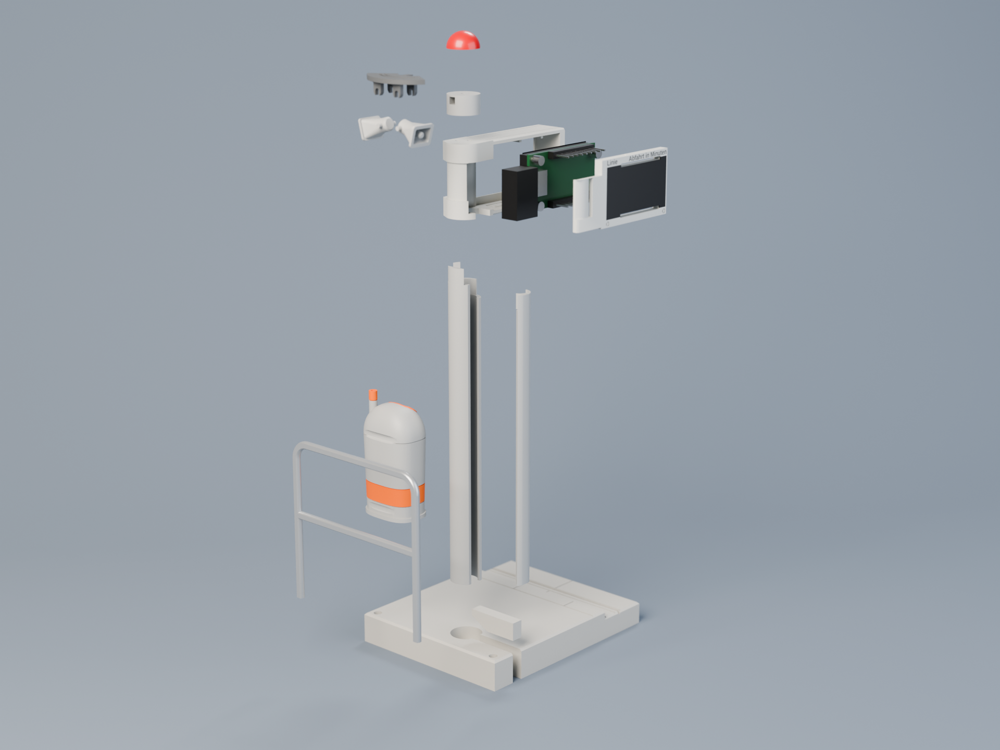
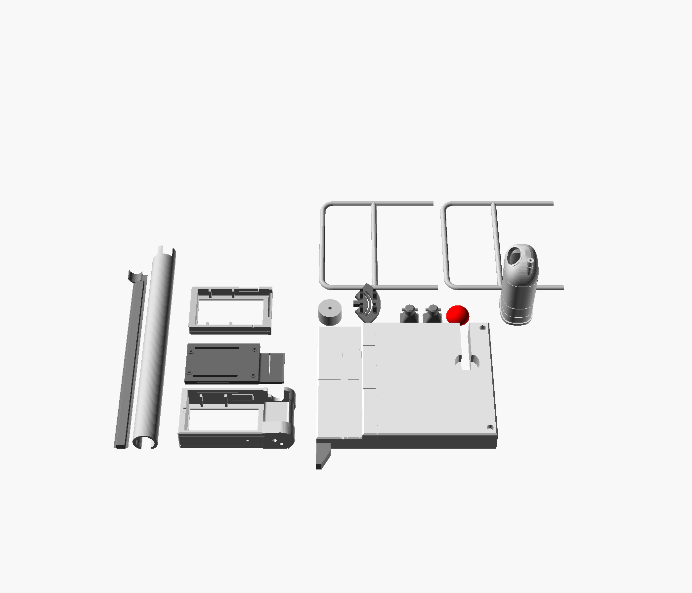
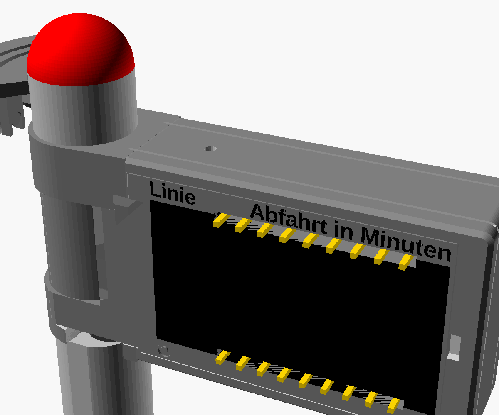

# Bimfo – the enclosure

A desk-sized, 3D-printable replica of the classic grey **"Linie … Abfahrt in Minuten"** departure
display at Vienna's tram and bus stops, about 1:15: the box on its pole with the band brackets, the
horn loudspeakers and the red cap, standing on a piece of tram platform and track with the railing
and the grey-and-orange litter bin ("Mistkübel"). Made for a Bambu Lab **A1 mini** (180 mm bed),
PLA, no supports.

With the Waveshare **ESP32-S3-LCD-1.47B** inside, it shows live departures (firmware: see the
[main README](../README.md)). Without it, it is a static model with a black, switched-off display,
or a lit one from the decal sheet.

| Static model | Exploded | Parts as printed |
|---|---|---|
|  |  |  |

## Choose your version

Two questions decide which version you print:

- **Live display or static model?** The live display needs the ESP32 board and a 90° USB-C cable.
- **Multicolour or single colour?** Multicolour needs an AMS (or another multi-material unit) and
  prints the black text, the black back window and the bin's orange into the parts. Single colour
  works on any printer; those details come from a printed decal sheet.

| | **Multicolour** (AMS) | **Single colour** (any printer) |
|---|---|---|
| **Live display** (with ESP32) | [**A**: Multicolour, live display](#a-multicolour-live-display) | [**C**: Single colour, live display](#c-single-colour-live-display) |
| **Static model** (no electronics) | [**B**: Multicolour, static model](#b-multicolour-static-model) | [**D**: Single colour, static model](#d-single-colour-static-model) |

Each version has its own print profile on MakerWorld with the same letter and name. The sections
below list what that version needs and which of the chapters further down to read, in order.

> **Nozzle:** a 0.4 mm nozzle prints every part. Only the small black text "Linie" /
> "Abfahrt in Minuten" (1.7 mm capitals) needs a **0.2 mm** nozzle to come out legible in
> multicolour. With 0.4 mm, print the text in the box colour too and use the label decal instead.

---

## A: Multicolour, live display

**Print profile:** *A · Multicolour · live display*

**You need:**
- a printer with AMS, loaded with light grey, black, red and orange PLA
- a 0.2 mm nozzle for legible text (otherwise see the nozzle note above)
- the electronics: [Waveshare ESP32-S3-LCD-1.47B and a 90° USB-C cable](#what-you-need-for-the-live-display)
- glue and a few pieces of 1.75 mm filament ([small parts](#small-parts-for-all-versions))

**Steps:**
1. [Check the board and your cable](#check-the-board-and-your-cable) with the two small test prints.
2. Print the [parts every version shares](#parts-every-version-shares).
3. Print the [multicolour parts with the board](#multicolour-parts).
4. [Assemble pole, base, railing and speakers](#assembly-every-version).
5. [Install the board](#assembly-installing-the-board) and close the box.
6. Install the firmware from the browser and set up the display: [main README](../README.md#installing-the-firmware).

Optional: the bin's slogan and dog stickers from the [decal sheet](#decals).

## B: Multicolour, static model

**Print profile:** *B · Multicolour · static model*

**You need:**
- a printer with AMS, loaded with light grey, black, red and orange PLA
- a 0.2 mm nozzle for legible text (otherwise see the nozzle note above)
- glue and a few pieces of 1.75 mm filament ([small parts](#small-parts-for-all-versions))

No electronics, no cable.

**Steps:**
1. Print the [parts every version shares](#parts-every-version-shares).
2. Print the [multicolour parts for the static model](#multicolour-parts).
3. [Assemble pole, base, railing and speakers](#assembly-every-version).
4. [Close the box with the display stand-in](#assembly-closing-the-static-model).

Optional: a lit departure board for the window, and the bin's slogan and dog stickers, from the
[decal sheet](#decals).

## C: Single colour, live display

**Print profile:** *C · Single colour · live display*

**You need:**
- any printer, with light grey PLA for almost everything, plus red (cap) and black (optional, for the
  speaker plate)
- the electronics: [Waveshare ESP32-S3-LCD-1.47B and a 90° USB-C cable](#what-you-need-for-the-live-display)
- the [decal sheet (PDF)](decals/decals.pdf), printed on decal film or sticker paper ([how to use it](#decals))
- glue and a few pieces of 1.75 mm filament ([small parts](#small-parts-for-all-versions))

**Steps:**
1. [Check the board and your cable](#check-the-board-and-your-cable) with the two small test prints.
2. Print the [parts every version shares](#parts-every-version-shares).
3. Print the [single-colour parts with the board](#single-colour-parts).
4. [Assemble pole, base, railing and speakers](#assembly-every-version).
5. [Install the board](#assembly-installing-the-board) and close the box.
6. Apply the [decals](#decals): box labels front and back, the back window, the bin.
7. Install the firmware from the browser and set up the display: [main README](../README.md#installing-the-firmware).

## D: Single colour, static model

**Print profile:** *D · Single colour · static model*

**You need:**
- any printer, with light grey PLA for almost everything, plus red (cap) and black (display
  stand-in)
- the [decal sheet (PDF)](decals/decals.pdf), printed on decal film or sticker paper ([how to use it](#decals))
- glue and a few pieces of 1.75 mm filament ([small parts](#small-parts-for-all-versions))

No electronics, no cable.

**Steps:**
1. Print the [parts every version shares](#parts-every-version-shares).
2. Print the [single-colour parts for the static model](#single-colour-parts).
3. [Assemble pole, base, railing and speakers](#assembly-every-version).
4. [Close the box with the display stand-in](#assembly-closing-the-static-model).
5. Apply the [decals](#decals): box labels front and back, a display for each window, the bin.

---

## Parts every version shares

PLA, 0.4 mm nozzle, 0.2 mm layers unless noted, 3 walls, 15 % gyroid, no supports. Everything
fits the A1 mini's 180 mm bed.

| Part | Filament | How it lies on the bed |
|---|---|---|
| `pole` | Grey | On the narrow flat along its back, so the front comes out perfectly round. Use a brim. |
| `pole_cover` | Grey | On its round outer face (a 3 mm flat along the crest touches the bed), tongue up. Use a brim. |
| `pole_top` | Grey | Upright. |
| `cap` | Red | Flat side down. |
| `speaker_bracket` | Dark grey or black | Plate top down, hangers up. |
| `horn` (×2) | Grey | On the mouth lip, driver up. |
| `base` | Grey | Top up. The edge stones, track slabs and rail are drawn by joints, so it is one colour. |
| `base_strip` | Grey | On its side. |
| `fence_half` (×2) | Grey | On the cut face; both halves come out round. (Or `fence` in one piece, on its flattened roadway side; that side comes out rougher.) |
| `can` | Grey (+ orange) | Upright on its flange. Its orange is set in the [multicolour](#multicolour-parts) or [single-colour](#single-colour-parts) chapter. |

Everything except the cap (and the bin, if it gets its orange) can share one grey plate.

### Small parts for all versions

- Three 7 mm pieces of 1.75 mm filament as dowels: two for the pole top, one for the cap.
- Three 1.8 mm pieces of filament as pins for the two railing halves.
- Glue: CA or a PLA-friendly glue.
- Optional: four rubber feet, Ø 8 mm (the base has recesses for them).

## Multicolour parts

The box face and the back cover are Bambu Studio projects: each is one object with the text (and the
back window) as a second part on filament 2. Open the 3MF and map filament 2 to black.

| Part | File | Filament |
|---|---|---|
| Box (front) | `shell_with_labels.3mf` | Light grey + black text. Face down. |
| Back cover, live display | `back_with_labels.3mf` | Light grey + black window and text. Outer face down. Has slits for the board's pin headers. |
| Back cover, static model | `back_closed_with_labels.3mf` | Light grey + black window and text. Outer face down. Closed. |
| Display stand-in (static model only) | `screen_dummy.stl` | Black. Display face down: on the textured plate it comes out matte, like a switched-off display. |

- **Box face down on the textured PEI plate.** That gives the matte, powder-coated look. The 3MF
  projects print at 0.16 mm layers. The text sits in the first layer, which they print slowly
  (25 mm/s, infill 30 mm/s) with 0.42 mm lines, so the small letters stay put. Keep *Arachne* (the
  default) and *Detect thin walls* on.
- **The text needs a 0.2 mm nozzle** to be legible (1.7 mm capitals). With 0.4 mm, map filament 2
  to light grey as well, so the face comes out flat, and apply the label decal from the
  [decal sheet](#decals).
- **The bin's orange:** set filament changes on the layer slider (right-click, *Change filament*):
  orange at **6.0 mm**, back to grey at **13.0 mm** (the "Misttelefon" band), and orange again at
  **43.3 mm** (the tip of the ash tube). Paint the rim of the opening orange, or leave it grey.
- **To build the projects yourself:** select the part and its inlay (for example `shell.stl` and
  `labels.stl`) in **one** import and answer "Yes" to *load as a single object with multiple
  parts*. Importing them one at a time, or with *Add part*, puts the letters next to the box instead
  of in it.

## Single-colour parts

Print the same projects as in multicolour, but with every part in light grey, so the faces come out
flat; the text and the windows come from the decal sheet.

| Part | File | Filament |
|---|---|---|
| Box (front) | `shell_with_labels.3mf`, both parts light grey | Light grey. Face down. |
| Back cover, live display | `back_with_labels.3mf`, both parts light grey | Light grey. Outer face down. |
| Back cover, static model | `back_closed_with_labels.3mf`, both parts light grey | Light grey. Outer face down. |
| Display stand-in (static model only) | `screen_dummy.stl` | Black. Display face down. |

- Print the box face down on the textured PEI plate (see the multicolour notes); the 3MF keeps the
  slow first layer, which also gives a clean face.
- The bin is plain grey; the band and the ash tube's tip are decals. Or pause at the heights given
  for [multicolour](#multicolour-parts) and swap to orange by hand.

## Decals

[`decals/decals.pdf`](decals/decals.pdf), two A4 pages, printed at **100 %** (check the 50 mm scale bar). Clear decal film
(waterslide or clear sticker film) works for everything; plain white sticker paper works for all but
the clear box labels, which have a grey version for it.

| Decal | Used by | Where |
|---|---|---|
| Box labels "Linie" / "Abfahrt in Minuten", front and back | C, D (and A/B with a 0.4 mm nozzle) | Strip ends flush with the window's sides, bottom edge on the window's top edge. Clear film: the black-only strips; sticker paper: the grey strips, which reach up to the face's chamfer (front) or the back cover's edge (back). |
| Display, front | B, D (optional) | On the face of `screen_dummy`, edges flush: a lit departure board instead of a dark one. |
| Display, back | C, D (A, B optional) | Into the back cover's black window. On a single-colour back there is no black window: centre the decal on the cover, 2.67 mm from its top and bottom edges, its sides 0.9 mm beyond the centres of the two screw marks. |
| Display variants (page 2) | as above | Five real tram stops: Paulanergasse, Schottentor, Oper, Rathausplatz/Burgtheater, Zentralfriedhof. |
| Bin band "Misttelefon", ash tube tip | C, D | Band between the two grooves, once round the bin, joint at the back. Tip round the top of the ash tube. |
| Bin slogan sticker, dog sticker | all (optional) | On the front of the bin: slogan 2 mm below the lid seam, dog sticker between it and the band. |

The grey of the sticker-paper labels is one colour (`boxgrey` in `decals/decals.tex`); compare it
with your print and adjust it if needed. Rebuild the sheet with `node make_matrix.js && xelatex
decals.tex` in `decals/`.

## Assembly: every version

1. **Pole and box.** Glue the pole to the bottom of the box: the two nibs on its top slot up into
   the lower bracket, and the pole's end butts against the box bottom. The nibs and the flat on the
   pole's back key its rotation, so the rear slot faces backwards.
2. **Pole and base.** Glue the pole's other end into the base socket, with the pole's rear slot
   lined up with the slit in the base.
3. **Pole top and cap.** Glue the pole top onto the box with two filament dowels, then the cap on
   top with the third.
4. **Speakers.** Drop each horn's pivot pins into the slots of a yoke under the speaker plate, tilt
   the horns about 15° downwards and fix them with a drop of glue. Push the plate's peg into the
   square socket on the side of the pole top facing away from the display, so one horn faces the
   front and one the back, and glue it.
5. **Railing.** Glue the two railing halves together on a flat surface, with a 1.8 mm piece of
   filament in each of the three pin holes (one half is the other turned round). Push its two posts
   into the sockets on the roadway side of the base, with a drop of glue.
6. **Bin.** Press the bin's back against the railing, so the top and lower rail sit in the two
   grooves across its back, opening towards the platform, and glue it.

Then continue with [installing the board](#assembly-installing-the-board) (live display) or
[closing the static model](#assembly-closing-the-static-model).

## Assembly: installing the board

1. Plug the 90° cable into the board, with the cable pointing down toward the BOOT edge.
2. From the back, put the board into the box face-first, glass against the bezel, USB toward the
   pole. The plug head drops into the pole section and its boot into the top of the pole.
3. Snap in the back cover (`back_with_labels`). Its four pins locate in the brass standoffs and its
   pads press the board against the bezel. If the board rattles, or the cover won't close, adjust
   `stack_h` ([parameters](#parameters)). To open it again, pry at the notch on the antenna end.
4. Lay the cable down the pole's rear slot and on into the base: it leaves the slot inside the
   socket and drops through the base's slit to the table, then runs out at the back edge. Press the
   base strip into the slit from above, flush with the platform.
5. Press the pole cover into the pole's rear slot from behind until its lip snaps in, top end
   first: its widened top closes the opening around the plug's boot.

The board's **BOOT** button (short press: switch between the WL and ÖBB style; hold 3 s: setup
Wi-Fi) is the flexure tab in the bottom of the box, near the pole: press it from below. **RST** is the pinhole in the top of the box
above it.

## Assembly: closing the static model

1. Put `screen_dummy` into the box from the back, display face against the bezel, like the board.
2. Snap in the closed back cover (`back_closed_with_labels`). Its four pins locate in the stand-in's
   standoffs and press it against the bezel.
3. Press the base strip into the base's slit, flush with the platform, and the pole cover into the
   pole's rear slot until its lip snaps in, top end first. A little glue is optional.

## What you need for the live display

- **Waveshare ESP32-S3-LCD-1.47B** ([wiki](https://www.waveshare.com/wiki/ESP32-S3-LCD-1.47B)), with
  or without soldered pin headers: the back cover has slits for them.
- **A 90° "side-angle" (left/right) USB-C cable**, cable Ø ≤ 4.4 mm, whose cable leaves the head
  along the plug's long axis. A straight plug sticks out about 25 mm and does not fit. USB-C is
  reversible, so left- and right-angle both work: insert it so the cable points down. The model is
  sized for a rigid head of 11 × 17.5 × 7.2 mm with the strain-relief boot continuing into the pole,
  about the size of the Lindy 32005. *Alternative:* solder a thin two-core lead to the VBUS and G pads
  next to the USB port (and unplug it before connecting USB for flashing).
- A USB power supply.

### Check the board and your cable

1. **`fittest.stl` (about 10 min):** a 6 mm slice of the front. Put the board in face-first: the
   screen should be centred in the window, the PCB should sit between the four ribs without forcing,
   and the BOOT/RST switches must not touch the walls.
2. **The cable test (about 25 min):** `cabletest.stl` (face down, like the box), `cabletest_pole.stl`
   (on its back flat, like the pole) and `cabletest_cover.stl` (arc down, like the pole cover). Plug
   the cable into the board and lay the board face-first into the box piece; slide the pole piece's
   nibs up into the bracket and press the cover piece into the pole's rear slot. It fits if the board
   lies flat on the bezel, the plug head clears its pocket, the boot goes into the pole without
   pushing the board up, and the cover piece closes round the boot. Press the BOOT flexure in the
   box piece's bottom wall: it should click the button.

If either doesn't fit, adjust the model ([parameters](#parameters)) and print the test again.

---

## Files

| File | What |
|---|---|
| `wl_display.scad` | Parametric source (OpenSCAD 2021.01+). `part=` picks what to render. |
| `stl/shell.stl`, `stl/labels.stl`, `stl/shell_with_labels.3mf` | Box with both brackets and the pole section between them, its text inlay, and both as one Bambu Studio project. |
| `stl/back.stl`, `stl/back_labels.stl`, `stl/back_with_labels.3mf` | Snap-in back cover with slits for the board's pin headers, its inlay (mock window and text), and both as a project. |
| `stl/back_closed.stl`, `stl/back_closed_labels.stl`, `stl/back_closed_with_labels.3mf` | The same, closed, for the static model. |
| `stl/screen_dummy.stl` | Static model: stand-in for the board, with its outline and standoffs. |
| `stl/pole.stl`, `stl/pole_cover.stl`, `stl/pole_top.stl`, `stl/cap.stl` | Pole with the rear cable slot, the round cover for that slot, the pole above the box, the red cap. |
| `stl/speaker_bracket.stl`, `stl/horn.stl` | Fan-shaped speaker plate with two yokes; the PA horn (print two). |
| `stl/base.stl`, `stl/base_strip.stl` | Platform and track with the pole socket and a cable slit; the strip that closes the slit. |
| `stl/fence_half.stl`, `stl/fence.stl` | Tube railing as two halves to pin together, or in one piece. |
| `stl/can.stl` | The Mistkübel, with the ash tube and two grooves that sit on the railing. |
| `stl/fittest.stl`, `stl/cabletest*.stl` | Fit test for the board; cable fit test (box end, pole top, pole cover top). |
| [`decals/decals.pdf`](decals/decals.pdf) | The decal sheet. Source `decals/decals.tex` (xelatex, font in `decals/fonts`); the display matrices come from `decals/make_matrix.js`. |
| `img/makerworld/` | Rendered images, made with [`render/`](render/README.md). |

Regenerate a part with `openscad -o stl/shell.stl -D 'part="shell"' wl_display.scad`; the closed
back cover with `-D header_pins=false`. After changing the box or a back cover, rebuild its 3MF.

## Parameters

Measured on one board and one cable; check these if your parts differ:

| Parameter | Default | What |
|---|---|---|
| `stack_h` | 8.3 | Front of the LCD glass to the tips of the brass standoffs. If the board rattles, raise it by 0.2; if the back cover won't close, lower it. |
| `glass_to_pcb` | 3.6 | Front of the glass to the front of the PCB (sets USB and button height). |
| `aa_dx`, `aa_dz` | 0 | Offset of the visible screen centre from the PCB centre. |
| `win_dx` | -1.2 / -1.0 | Shift of the window edge on the antenna / USB side (+ = towards USB). The first fit test showed the screen about 1.1 mm towards the antenna end. |
| `boot_nub` | 0.1 | Nub on the BOOT flexure. Raise it if a press does nothing; lower it if the device acts as if BOOT is held. |
| `header_pins`, `header_len`, `header_slit_w` | true, 8.5, 1.3 | Slits for soldered pin headers. Trim the pins and lower `header_len` so they stop 0.8 mm short of the back, and the slits become blind pockets; `header_pins = false` for a board without headers. |
| `pole_side` | "right" | `"left"` mirrors the model (the board turns 180°: enable *Anzeige um 180° drehen* on the settings page). |
| `pole_below` | 110 | Pole height under the box; 140 gives true 1:15 and still fits the bed. |

**Your 90° USB-C cable** (all in mm; too-large values are rejected by checks in the model):

| Parameter | Default | Measure |
|---|---|---|
| `plug_depth` | 11 | Head length from the receptacle face (where the plug's metal shell enters the socket) to the far end of the head |
| `plug_up` | 6.5 | From the plug's centreline to the top end of the rigid head |
| `plug_down` | 11 | From the centreline to the bottom end of the rigid head, where the soft boot starts |
| `plug_thick` | 7.2 | Thickness of the head (front to back of the box) |
| `boot_offset` | 5.5 | From the receptacle face to the centre of the boot, along the plug |
| `boot_d` | 6.2 | Boot diameter at its thickest, plus about 0.4 mm clearance |
| `boot_len` | 7 | Boot length below the head, until the cable is thin enough to bend |
| `cable_d` | 4.4 | Cable diameter (sets the slots in the pole and the base) |

Then re-export `shell`, `back` (and the 3MF projects), `pole`, `pole_cover`, `base`, `base_strip`
and the cable test pieces.

## What it is modelled on

- **The original:** a grey (about RAL 7035) sheet-metal AEG box with an amber LED dot-matrix behind
  a dark window, known as the *Echtzeitanzeige*. "Linie" is printed top left and "Abfahrt in
  Minuten" top right, aligned to the window edges, with two screws below the window. Two stainless
  band brackets hold it to a round grey pole. The box is double-sided, so the replica's back repeats
  the front. Just under the cap, a fan-shaped plate on the side away from the display carries two
  horn loudspeakers facing front and back, tilted slightly down. A red half-ball sits on top.
  [Photo on Wikimedia Commons](https://commons.wikimedia.org/wiki/File:Tajperaro_sur_pasa%C4%9Der-informa_indikilo.jpg).
- **The platform:** an asphalt platform with concrete edge stones along the track, the track in
  concrete slabs. On the roadway side, the city's litter bin hangs on the plain tube railing rather
  than on its own post ([bin on a stop railing](https://commons.wikimedia.org/wiki/File:Wien-Hernals_-_Mistk%C3%BCbel_-_I_tram_von_Mist.jpg),
  [front view](https://commons.wikimedia.org/wiki/File:Wien-H%C3%BCtteldorf_-_Mistk%C3%BCbel_-_Einwurf.jpg)).
- **No official drawing is public.** Proportions were measured off photos (face about 1.75 : 1,
  window about 80 % of the face width, depth about 25 % of the width); the replica's face is
  41.3 × 27.1 mm, depth 13 mm.
- The newer red "Info-Säule" poles ([design](https://www.lukasbast.at/portfolio/wiener-linien-haltestelle/))
  and the commercial [catch.it / Straba](https://www.memoba.at/produkt/Memoba_mb98010_Catch.it,_Deine_pers%C3%B6nliche_Haltestelle_im_Mini-Format,_mit_Echzeitanzeige,_H%C3%B6he_307mm_.html)
  mini-stops follow the newer style. Bimfo is the classic box, designed from scratch.

### Where the hardware forced deviations

| Item | Original | Replica | Why |
|---|---|---|---|
| Window | about 2.3 : 1 | 1.83 : 1 (33.6 × 18.4) | The LCD's active area is 32.35 × 17.39 mm. |
| Pole | about 0.15 × box width, clear gap to the box | 12 mm (0.25 × box width), 1.8 mm gap | It carries the USB cable; the plug's boot drops into the pole next to the USB port, which caps the gap. |
| Gap between the brackets | Open | A flat plate 1.2 mm behind the face | It hides the plug head on its way into the pole. |
| Cable in the pole | — | A slot along the pole's back, closed by a round cover | Both cable ends carry plugs, so the cable is laid in from behind. |
| Top of the pole below the box | Plain | An opening at the back for the plug's boot, closed by the pole cover's top end | The boot comes in from the back with the board. |
| Base | Full-size platform and track | Compressed: edge 3 mm beyond the box, near rail 7 mm from the curb | A desk vignette (`road_w`, `rail_off`, `edge_w`, `block_l`). |
| Pole height | Box at about 2.2 m | Box bottom 110 mm above the base | Desk use; `pole_below = 140` is true 1:15. |

### Board data used

From the [Waveshare wiki drawing](https://www.waveshare.com/wiki/ESP32-S3-LCD-1.47B) and the
[LCD spec](https://www.waveshare.com/1.47inch-lcd-module.htm): PCB 36.37 × 20.32 mm; M2 brass
standoffs at (1.97, 3.52), (1.97, 16.80), (33.97, 2.00) and (33.97, 18.32) from the antenna end;
LCD active area 32.35 × 17.39 mm; USB-C on the short edge, sticking out about 1.5 mm; BOOT and RST on
the long edges, 6.9 mm from the USB end; pin headers (if soldered) two rows of 9 along the long
edges, 1.27 mm in from each edge, ending 8.5 mm behind the PCB.

The chip antenna is at the end away from the USB, in the free end of the box. Use plain PLA there,
not metal- or carbon-filled filament.

## Licence

The enclosure is licensed under [CC BY-NC-SA 4.0](LICENSE): print, share and remix it for
non-commercial use, credit "Bimfo by Sebastian Röder", and share remixes under the same licence. Selling
prints, kits or the files needs permission. The fonts on the decal sheet and the departure data
on the display decals keep their own licences; see
[THIRD_PARTY_NOTICES.md](../THIRD_PARTY_NOTICES.md). The firmware is MIT.
